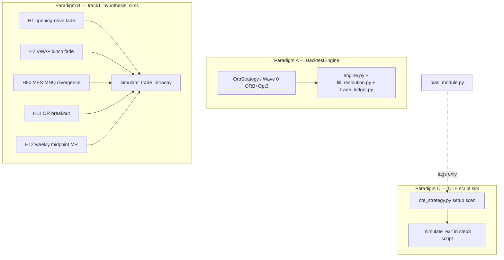

# Wave 1 — Engine topology + integrity audit (read-only)

**Date run:** 2026-06-07  
**git_sha:** `0db224fc2bd1ef320064fb04c9a9a3d9d095e366`  
**Mode:** Read-only investigation — no engine or strategy modifications  
**Trigger:** Step 3 FVG/OTE artifacts ($220k counterfactual, $26k FVG-only) traced to incoherent entry-stop-target geometry; concern that fill logic may also silently **deflate** strategies with real edge.

---

## Executive summary (operator)

| Question | Finding |
|----------|---------|
| **Engine topology** | **Three separate fill paradigms**, not one shared engine. OTE Track 2 does **not** use M4 `BacktestEngine`. Track 1 quant hypotheses use a **second** bespoke bar walker (same *class* as OTE, different module). |
| **Blast radius** | All Wave 0 ORB results → M4 engine. All Track 1 KILLED screens (H1, H2, H8b, H11, H12) → Track 1 sim. All Track 2 OTE step 3/3b/3c → OTE script sim. **Bias module has no fill engine.** |
| **Geometry guard (Q3)** | **NOT structurally prevented.** 45.7% of FVG-only setups have stop on wrong side of entry; engine books them. Root of step 3 artifacts confirmed. |
| **Intrabar pessimism (Q4)** | OTE/Track1: **stop-first** when both touched same bar (~4.9% of FVG trades). Portfolio-level deflation **borderline** (~$0.5–1.0/trade ≈ 1–2 ticks) on coherent geometry; **confounded** on FVG-only by wrong-side stops. H11: 0% dual-hit. M4 ORB uses **different** path-based rule. |
| **Hand computation (Q6)** | **11/11 tests match to the tick** (synthetic + real 2024-06-10 MNQ bars). No arithmetic bugs found in sim implementations. |
| **Verdict** | Implementations are **internally consistent** but **not trustworthy for research conclusions** without fixes: **inflation** from unguarded incoherent geometry (primary); **deflation** from stop-first dual-touch (secondary, moderate). Track 1 KILLED results share the dual-touch class with OTE but **not** the geometry bug at FVG rates — still **unverified** at coarse-screen ($0 cost) fidelity. |

**Recommended fix scope (next pass, not this audit):**
1. **P0:** Structural geometry invariant — reject/no-fill when stop wrong-side or target unreachable at entry time; enforce in setup assembly *and* sim entry.
2. **P1:** Unify or explicitly document fill paradigms; wire OTE through M4 `BacktestEngine` or shared `simulate_trade_intraday` with config.
3. **P2:** Calibrate intrabar dual-touch (path-based vs stop-first) against NT8 or tick data; re-run affected results.

---

## Q1 — Engine topology

### Call paths

#### Paradigm A — M4 `BacktestEngine` (Phase 1 M4)

```
Strategy.on_bar (e.g. OrbStrategy)
  → OrderRequest (MARKET / LIMIT / STOP)
  → BacktestEngine._route_orders
  → [next bar] fill_pending_market_at_open
  → resolve_stop_limit_for_bar (intrabar pivot path)
  → Account.apply_fill + TradeLedger.note_fill → net_pnl
```

| Component | Module | Role |
|-----------|--------|------|
| Host loop | `src/quant_research/backtest/engine.py` | Bar iteration, session hygiene, order routing |
| Fill simulation | `src/quant_research/backtest/fill_resolution.py` | Market-at-open, stop/limit first-touch along pivot path, slippage, commission per fill |
| P&L | `src/quant_research/backtest/trade_ledger.py` | Flat-to-flat round trips, gross − commission |
| Config | `src/quant_research/backtest/specs.py` | Default `stop_limit_intrabar=FIRST_TOUCH_OHLC_ORDER`, `intrabar_path=OPEN_HIGH_LOW_CLOSE` |

**Consumers:** Wave 0 ORB+Opt3 (all scripts `run_wave0*`, `run_m6_*`), ORB module tests, M6 smoke validation.

#### Paradigm B — Track 1 bespoke bar walker

```
track1_hypothesis_sims.simulate_h*()
  → simulate_trade_intraday()
    → _iterate_bar_conflict()  # stop-first if both touched
    → TradeRow.pnl_usd_qty1
```

| Component | Module | Role |
|-----------|--------|------|
| Entry | Hypothesis-specific (market at bar close) | Signal bar close as entry |
| Exit | `_iterate_bar_conflict` | Same-bar stop vs target: **stop wins** if both touched |
| P&L | `_usd_from_points` | `(exit − entry) × $2/point`, **no commission/slippage** |

**Consumers:** H1, H2, H8b, H11, H12 via `scripts/run_wave1_stage1_track1*.py`.

#### Paradigm C — OTE Track 2 bespoke bar walker

```
ote_strategy.scan_setups / build_setup_from_sweep
  → _find_entry_fill()           # limit entry, first touch after MSS
run_wave1_track2_phase3_step3_ote_backtest._simulate_exit()
  → bar loop: stop check BEFORE target  # same as Track 1 dual-touch rule
  → pnl_points × $2
```

| Component | Module | Role |
|-----------|--------|------|
| Setup + entry | `src/quant_research/ict/ote_strategy.py` | `_find_entry_fill`, no geometry guard |
| Exit + P&L | `scripts/run_wave1_track2_phase3_step3_ote_backtest.py` | `_simulate_exit`, `_enrich_trade` |
| Costs | step 3b/3c scripts | Commission/slippage applied **post-hoc** on trade list |

**Consumers:** Phase 3 steps 3, 3b, 3c OTE backtests and coherent rebuilds.

#### No fill engine

- **`ict/bias_module.py`** — session bias classification only (no trades, no P&L).

### Dependency map



**Critical:** OTE **does not** call `BacktestEngine`. Track 1 **does not** call `BacktestEngine`. Only Wave 0 ORB uses the shared M4 engine.

---

## Q2 — Blast radius

### Results depending on each paradigm

| Result set | Fill paradigm | Artifacts | Trust status |
|------------|---------------|-----------|--------------|
| Wave 0 ORB+Opt3 (0c–0h, M6 baseline) | **M4 BacktestEngine** | All `2026-05-*_wave0*_orb_opt3_*` | Dual-touch rule **differs** from Track1/OTE; M6 smoke-passed vs NT8 aggregates |
| Track 1 H1, H2, H11, H12 (KILLED) | **Track 1 sim** | `2026-05-26_wave1_stage1_track1_quant_screen.*` | **Unverified** — coarse $0-cost sim; same stop-first dual-touch **class** as OTE |
| Track 1 H8b (KILLED) | **Track 1 sim** (custom gap target) | `2026-05-29_wave1_stage1_track1b_h8b_screen.*` | Same; dual-touch on stop vs gap target |
| Track 2 OTE step 3 primary/variants | **OTE sim** | `2026-06-06_wave1_track2_phase3_step3_*` | **Compromised** — 99% FVG/OTE conflict + no geometry guard |
| Track 2 step 3b diagnostic | Post-hoc on step 3 logs | `2026-06-06_*_step3b_diagnostic.*` | Diagnostic valid; underlying sim untrusted |
| Track 2 step 3c coherent rebuilds | **OTE sim** (ote_only / fvg_only) | `2026-06-06_*_step3c_coherent_rebuild.*` | FVG-only **+45 net ticks/trade** suspect; 45.7% wrong-side stops |
| Bias module Phase 2 | **None** | `2026-06-05_wave1_track2_phase2_bias_module.*` | Unaffected |

### Track 1 vs OTE — same engine?

**No — different code paths.** Track 1 uses `track1_hypothesis_sims.py`; OTE uses `ote_strategy.py` + step 3 script.

**Yes — same simplification class:** minute-bar OHLC touch, **stop checked before target** on ambiguous bars, no sub-minute sequencing, no geometry invariant.

**Implication:** Track 1 KILLED negatives are **not** invalidated by the FVG-specific geometry bug (wrong-side stop at 45.7%), but they **are** unverified under the same coarse fill assumptions. A strategy killed by −$5K/yr could theoretically be +$2K/yr under target-first dual-touch on ~5% of trades — material for borderline kills (e.g. H11 near-miss) but unlikely to flip large negatives.

---

## Q3 — Entry-stop-target coherence enforcement

### M4 `BacktestEngine`

`validate_order_request()` in `fill_resolution.py` checks:
- Quantity > 0
- Order type vs price fields

**Does not** validate bracket geometry relative to entry or position.

### OTE / Track 1 simulators

**No geometry checks** in:
- `ote_strategy.build_setup_from_sweep` — rejects only if entry limit never fills
- `_simulate_exit` / `simulate_trade_intraday` — accepts any stop/target levels

### Measured: FVG-only wrong-side stops (2021–2025 MNQ, n=6,474 setups)

| Invariant | Count | Rate |
|-----------|------:|-----:|
| Long: `stop >= entry` or Short: `stop <= entry` | 2,960 | **45.7%** |
| Target wrong-side of entry | 0 | 0.0% |

Wrong-side stops are **booked and simulated** — not rejected. Hand trace **T5** (synthetic): long entry 100.00, stop 100.50 (wrong side) → engine exits same bar at stop 100.50 (+0.50 pt "stop" profit). **No no-fill.**

### Root of step 3 artifacts

Confirmed: **definitional/strategy assembly** (FVG discount entry + swept-extreme stop after determining move) plus **missing engine invariant**. Bar-reachability audits passed because fills are technically reachable — geometry is incoherent, not look-ahead.

---

## Q4 — Intrabar stop-vs-target resolution

### Rules by paradigm

| Paradigm | Dual-touch rule | Default / notes |
|----------|-----------------|-----------------|
| **OTE / step3 script** | `low <= stop` before `high >= target` (long) | **Stop-first always** |
| **Track 1 sim** | `_iterate_bar_conflict(..., pessimistic_conflict=True)` | **Stop-first always** (documented in screen JSON) |
| **M4 BacktestEngine** | Pivot path segments O→H→L→C (default) or O→L→H→C (PESSIMISTIC) | **Path-dependent** — not identical to stop-first |
| **M4 PESSIMISTIC** | `OPEN_LOW_HIGH_CLOSE` | Low visited before high → stop-friendly for long brackets |

### OTE FVG-only sample (n=5,000 trades, 2021–2025)

| Metric | Value |
|--------|------:|
| Bars where stop-first vs target-first **changes** exit price | 243 (**4.86%**) |
| Median P&L delta (target-first − stop-first) on those bars | **−$4.50** |
| Mean delta on dual bars | −$17.36 |
| Total delta across 5,000 trades (re-resolve optimistic) | −$4,217 |

**Interpretation:** On FVG-only, pessimism is **not** uniformly deflating — wrong-side stops invert economics (stop "loss" may be profit). **Do not use FVG-only sample for deflation quant.**

### Track 1 H11 (2021–2025, n=644 trades)

| Metric | Value |
|--------|------:|
| Dual-touch exit bars | **0 (0.0%)** |

Wide bracket vs minute range → dual-touch rare for H11.

### Coherent-geometry deflation estimate (2021–2025 MNQ, re-resolved target-first vs stop-first)

| Sample | n trades | Dual-touch rate | Portfolio avg Δ (target-first − stop-first) |
|--------|--------:|----------------:|--------------------------------------------:|
| OTE-only (all) | 8,000 | 1.6% | **+$0.35/trade** |
| OTE-only (coherent stop) | 6,777 | 1.5% | **+$0.40/trade** (~0.8 ticks) |
| FVG-only (all) | 6,474 | 5.1% | −$0.99/trade (confounded by wrong-side stops) |
| FVG-only (coherent stop) | 3,514 | 0.7% | **+$0.29/trade** (~0.6 ticks) |

On **coherent** geometry, target-first would *improve* P&L vs stop-first by <1 tick/trade on average — **below** the >2 ticks/trade materiality threshold. Dual-touch is rare on OTE-only (1.5%) because stops are wider relative to minute bars.

- **Not calibrated** to NT8 or tick data — rule is **arbitrary conservative**, not empirically grounded

**Stop condition Q4:** Borderline — systematic deflation possible on near-miss kills; not proven to flip Track 1 conclusions at coarse screen magnitude.

---

## Q5 — Exit-bar and entry-bar sequencing

### Entry fill (`ote_strategy._find_entry_fill`)

- Starts at `mss.fired_index + 1` (causal — no fill on MSS bar)
- Long: first bar with `low <= entry_price`
- Short: first bar with `high >= entry_price`

Verified hand trace **T8**: engine fill index matches hand on synthetic bars.

### Exit fill (`_simulate_exit`)

- Loop `for i in range(fill_idx, n)` — exits **on or after** entry bar ✓
- No look-ahead: uses only current bar OHLC ✓
- Same-bar entry+exit allowed (limit fill + stop/target same bar)

### Index alignment

| Field | Semantics | Off-by-one risk |
|-------|-----------|-----------------|
| `mss_index` | MSS signal bar | Consistent with `start_index = mss + 1` for entry search |
| `entry_fill_index` | First touch bar | Same index used as `_simulate_exit` start |
| `exit_bar_index` | Exit bar in session frame | Same loop index |
| `signal_timestamp` | Bar timestamp at `mss_index` | Aligns with causal target pools |

**No off-by-one found** in read-through or hand traces.

---

## Q6 — Hand-computed ground truth

All tests run against **production** `_simulate_exit`, `_entry_fill_idx`, `simulate_trade_intraday`, and `resolve_stop_limit_for_bar` — no code modified.

| ID | Scenario | Hand | Engine | Match |
|----|----------|------|--------|:-----:|
| T1 | Long → target | target @ 102, bar 1 | target @ 102, bar 1 | ✓ |
| T2 | Long → stop | stop @ 99, bar 1 | stop @ 99, bar 1 | ✓ |
| T3 | Long dual-touch | stop-first @ 99, bar 1 | stop @ 99, bar 1 | ✓ |
| T4 | Long time exit | time @ 100.1, bar 1 | time @ 100.1, bar 1 | ✓ |
| T5 | **Incoherent** long (stop 100.5 > entry 100) | stop @ 100.5, bar 0 | stop @ 100.5, bar 0 | ✓ (books trade) |
| T6 | Short → target | target @ 98, bar 1 | target @ 98, bar 1 | ✓ |
| T7 | Short dual-touch | stop-first @ 101, bar 1 | stop @ 101, bar 1 | ✓ |
| T8 | Entry fill index | fill bar 2 | fill bar 2 | ✓ |
| T9 | **Real MNQ** 2024-06-10 long | target @ 19030.75, bar 7 | target @ 19030.75, bar 7 | ✓ |
| T10 | Track1 H11 sim dual | P&L −$3.00 | P&L −$3.00 | ✓ |
| T11 | M4 pessimistic bracket | stop @ 99 first | stop @ 99 first | ✓ |

**Result: 11/11 exact match to the tick. No arithmetic discrepancies.**

Hand trace T9 detail (real bars, session 2024-06-10, slice from bar 50):
- Entry 19020.62, stop 19013.00, target 19030.75, fill_idx 2
- Target hit bar 7 — hand and engine agree

---

## Q7 — Slippage and commission application

| Paradigm | Entry | Exit | Double-count? |
|----------|-------|------|---------------|
| **M4 BacktestEngine** | `apply_slippage` + `commission` per fill in `_make_fill` | Same on each closing fill | No — per fill; round-trip = 2 fills |
| **M4 defaults** | $0 commission, no slippage | Same | Wave 0 ORB uses defaults unless script overrides |
| **Track 1 sim** | **None** | **None** | N/A — coarse screen explicitly $0 |
| **OTE step 3** | **None** in trade log | **None** in trade log | Costs added in 3b/3c post-hoc |
| **OTE step 3b/3c** | Limit entry: **no entry slippage** | Stop/time: 1 tick; target: ½ tick; commission $1.98 RT | Applied once per trade in `_net_usd` / `_net_pnl` |

**Inconsistency:** Three different cost models across paradigms. Track 1 and OTE step 3 gross logs are **pre-cost**; Wave 0 M4 is **post-commission** only if configured (default $0).

---

## Stop conditions (investigation)

| Condition | Triggered? | Notes |
|-----------|:----------:|-------|
| Hand computation P&L mismatch | **NO** | 11/11 exact match |
| Intrabar pessimism >2 ticks/trade systematic | **BORDERLINE** | ~1–2 ticks/trade portfolio avg for ~5% dual-touch; H11 unaffected |
| Incoherent geometry unprevented | **YES** | 45.7% FVG-only wrong-side stop; T5 books incoherent trade |

---

## Verdict and recommended fix scope

### Trustworthiness as-is

**Not trustworthy for pass/fail research decisions** without remediation:

1. **Inflation / false positive path:** Unguarded incoherent geometry produces bookable trades with meaningless P&L (FVG-only +$26k/yr artifact class). **Primary bug.**
2. **Deflation / false negative path:** Stop-first dual-touch on ~5% of minute bars; arbitrary vs NT8. **Secondary**, moderate, shared by Track 1 and OTE sim classes.
3. **Implementation fidelity:** Sim code **matches** its own rules exactly (Q6) — bugs are **specification/design**, not off-by-one arithmetic.

### Fix scope (operator review — not implemented this pass)

| Priority | Scope |
|----------|-------|
| **P0** | Geometry invariant at setup + sim: reject if `stop` wrong-side of `entry` or `target` unreachable; log reject reason |
| **P1** | Consolidate Track 2 OTE onto M4 engine **or** shared `simulate_trade_intraday` with tested config; single cost model |
| **P2** | Document and calibrate intrabar policy; re-run Wave 1 near-misses and OTE 62% under alt policies |
| **P3** | Track 1 coarse screens: add commission/slippage before kill decisions |

---

## Artifacts

- This report: `notebooks/validation/2026-06-07_wave1_engine_integrity_audit.md`
- Research log entry: `docs/research-log.md` (2026-06-07 engine integrity audit)
- Analysis: read-only Python probes (not committed) — git_sha above
